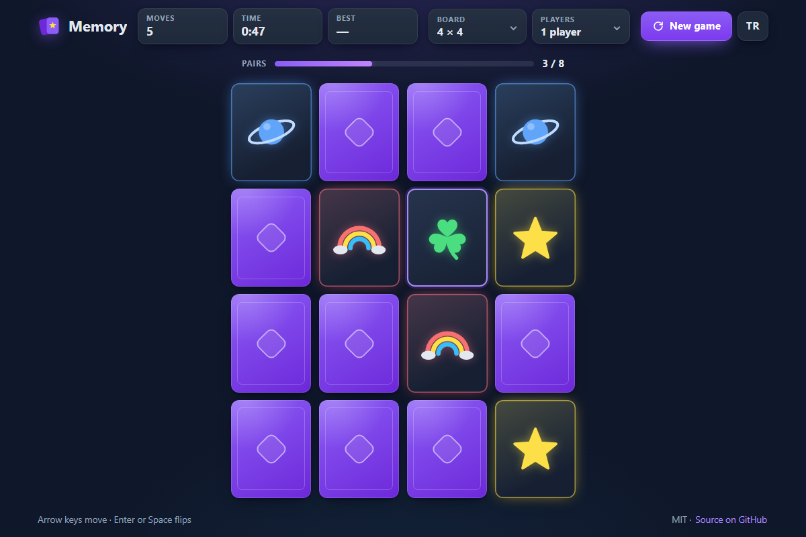

# Memory - flip two cards, find the pairs, beat your best

[](#tests)
[](LICENSE)

**▶ Play now: https://celaldrg.github.io/memory/**



A card-matching game for the browser. Turn over two cards at a time and remember where every symbol hides. It has three board sizes, a two-player mode on one device and a best result for each board size. Written in plain HTML, CSS and JavaScript modules, with no dependencies and no build step.

## Features

- Three boards: 4 × 4, 4 × 5 and 6 × 6 (8, 10 or 18 pairs).
- Play alone or with two players on one device. A player who finds a pair goes again.
- 18 original symbols drawn in code as inline SVG, each in its own color. No image files and no emoji.
- 3D card flips, a glow on found pairs and confetti made of CSS shapes when you win.
- A move counter and a timer. The best solo result for each board size is saved in your browser.
- English and Turkish interface. Your choice is remembered.
- Plays with touch, mouse or keyboard. Cards have labels, and screen readers hear every flip.
- Follows the system "reduce motion" setting.

## How to play

- Flip two cards per turn. If they show the same symbol, they stay face up. If not, they turn back after a moment. Find all pairs in as few moves as you can.
- **Two players:** take turns. Finding a pair earns another turn and a miss passes the turn on. The player with more pairs wins.
- **Touch or mouse:** tap or click a card.
- **Keyboard:** the arrow keys move between cards, Home and End jump to the start and end of a row, and Enter or Space flips the card. Tab reaches the buttons and menus.
- Pick the board size and the number of players in the header. **New game** starts over and **TR / EN** switches the language.
- **Best** is kept per board size for solo games: fewest moves first, then the shortest time. Its tile is shown only in solo games.

## Run locally

```sh
git clone https://github.com/celaldrg/memory.git
cd memory
npx serve .
```

Any static file server works, for example `npx serve .` or `python -m http.server`. Then open the address it prints. ES modules need `http://`, so opening `index.html` through `file://` does not work. Add `?demo` to the address to get the fixed mid-game board shown in the screenshot.

## Tests

```sh
node --test
```

The tests use only Node's built-in test runner, so there is nothing to install (CI runs Node 22). They cover:

- the game rules: flips, matches and misses, turns and scores with two players, the timer, winning and the demo board;
- building the deck for every board size and the seeded shuffle;
- best results per board size, and storage that never throws (for example in private browsing);
- the view model, keyboard navigation, time format, saved settings and the confetti plan;
- the card artwork: one color per symbol, built only from plain SVG shapes;
- the English and Turkish strings: both have the same keys and placeholders, and every key the page uses exists.

Randomness comes from a seeded generator, so every run gives the same results.

## Project structure

```text
index.html                 page markup, meta tags and icon
style.css                  dark theme, layout and card flip
src/
  main.js                  entry point: wires the controls, views and clock
  board-view.js            card grid with pointer and keyboard input
  hud-view.js              stat tiles and turn bar
  win-view.js              win overlay and confetti
  card-art.js              builds the SVG of a card face
  game.js  deck.js  rng.js  records.js  view-model.js  navigation.js
  confetti.js  settings.js  format.js  symbols.js  i18n.js
                           pure logic and data (no DOM), covered by the tests
  storage.js               localStorage wrapper that never throws
test/                      node:test suites
docs/screenshot.png        the screenshot above
```

## License

MIT © 2026 Celalettin Durgaç. See [LICENSE](LICENSE).

---

## Türkçe

**▶ Hemen oyna: https://celaldrg.github.io/memory/**

Hafıza, tarayıcıda oynanan bir kart eşleştirme oyunu. Kartları ikişer ikişer çevirirsin ve her sembolün yerini aklında tutarsın. Üç tahta boyutu, aynı cihazda iki oyunculu mod ve her tahta boyutu için en iyi sonuç kaydı var. Düz HTML, CSS ve JavaScript modülleriyle yazıldı. Bağımlılığı ve derleme adımı yok.

### Özellikler

- Üç tahta: 4 × 4, 4 × 5 ve 6 × 6 (8, 10 ya da 18 çift).
- Tek başına ya da aynı cihazda iki kişi oynanır. Çift bulan oyuncu bir daha oynar.
- Kodla SVG olarak çizilmiş 18 özgün sembol var ve her birinin kendi rengi var. Resim dosyası ya da emoji kullanılmadı.
- Kartlar 3B dönerek açılır, bulunan çiftler parlar, kazanınca CSS şekillerinden konfeti yağar.
- Hamle ve süre gösterilir. Her tahta boyutu için en iyi tek oyunculu sonuç tarayıcında saklanır.
- Arayüz İngilizce ve Türkçe. Seçtiğin dil hatırlanır.
- Dokunmatik ekran, fare ya da klavyeyle oynanır. Kartların etiketleri var ve ekran okuyucular her çevirmeyi duyurur.
- Sistemdeki "hareketi azalt" ayarına uyar.

### Nasıl oynanır

- Her turda iki kart çevir. İki kartta aynı sembol varsa kartlar açık kalır. Yoksa kısa bir süre sonra kapanırlar. Bütün çiftleri olabildiğince az hamlede bul.
- **İki oyuncu:** sırayla oynayın. Çift bulan bir daha oynar, bulamayan sırayı devreder. En çok çifti bulan kazanır.
- **Dokunmatik ya da fare:** karta dokun ya da tıkla.
- **Klavye:** ok tuşları kartlar arasında gezdirir. Home ve End satırın başına ve sonuna götürür. Enter ya da Boşluk kartı çevirir. Tab ile düğmelere ve menülere geçilir.
- Tahta boyutunu ve oyuncu sayısını üst bölümden seç. **Yeni oyun** oyunu baştan başlatır, **TR / EN** dili değiştirir.
- **En iyi** sonuç, tek oyunculu oyunlarda her tahta boyutu için ayrı tutulur. Önce hamle sayısına bakılır, hamleler eşitse süreye. Bu kutucuk yalnızca tek oyunculu oyunda görünür.

### Yerelde çalıştırma

```sh
git clone https://github.com/celaldrg/memory.git
cd memory
npx serve .
```

Herhangi bir statik dosya sunucusu iş görür, örneğin `npx serve .` ya da `python -m http.server`. Sonra sunucunun yazdığı adresi aç. ES modülleri `http://` ister, bu yüzden `index.html`'i `file://` ile açınca oyun çalışmaz. Adresin sonuna `?demo` eklersen ekran görüntüsündeki sabit oyun ortası tahtası açılır.

### Testler

```sh
node --test
```

Testler yalnızca Node'un yerleşik test aracını kullanır, kurulacak bir şey yok (CI, Node 22 ile çalışır). Kapsananlar:

- oyun kuralları: çevirme, eşleşme ve kaçırma, iki oyuncuda sıra ve puan, süre, kazanma ve demo tahtası;
- her tahta boyutu için deste oluşturma ve tohumlu karıştırma;
- tahta boyutu başına en iyi sonuç ve hiç hata fırlatmayan depolama (örneğin gizli sekmede);
- görünüm modeli, klavyeyle gezinme, süre biçimi, kayıtlı ayarlar ve konfeti planı;
- kart çizimleri: her sembolün ayrı bir rengi var ve çizimler yalnızca düz SVG şekillerinden oluşur;
- İngilizce ve Türkçe metinler: iki dilde de aynı anahtarlar ve yer tutucular var, sayfanın kullandığı her anahtar tanımlı.

Rastgelelik tohumlu bir üreteçten gelir, bu yüzden her çalıştırma aynı sonucu verir.

### Proje yapısı

```text
index.html                 sayfa yapısı, meta etiketleri ve simge
style.css                  koyu tema, yerleşim ve kart çevirme
src/
  main.js                  giriş noktası: kontrolleri, görünümleri ve saati bağlar
  board-view.js            kart ızgarası, dokunma ve klavye girişi
  hud-view.js              sayaç kutuları ve sıra çubuğu
  win-view.js              kazanma penceresi ve konfeti
  card-art.js              kart yüzünün SVG'sini kurar
  game.js  deck.js  rng.js  records.js  view-model.js  navigation.js
  confetti.js  settings.js  format.js  symbols.js  i18n.js
                           saf mantık ve veri (DOM yok), testlerle kapsanır
  storage.js               hiç hata fırlatmayan localStorage sarmalayıcısı
test/                      node:test test dosyaları
docs/screenshot.png        yukarıdaki ekran görüntüsü
```

### Lisans

MIT © 2026 Celalettin Durgaç. Ayrıntılar için [LICENSE](LICENSE) dosyasına bak.
